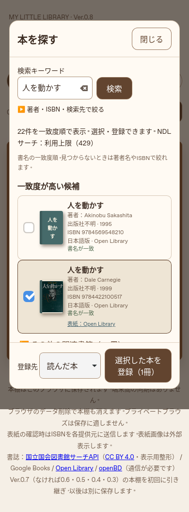
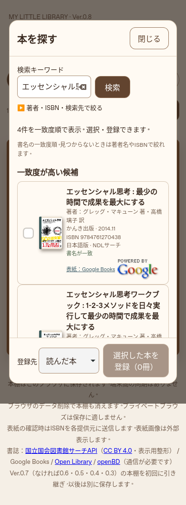

# Ver.0.8 検索順位・検索体験の改善と検証

検証日：2026-11-17。実機のVer.0.7で検索自体は成功していることを前提に、候補取得・適合性・表示を改善しました。既存HTMLは変更せず、`index-v08.html` を追加しています。追加の有料契約・秘密のAPIキーは不要です。

## 原因と確認した仕様

- Ver.0.7は最初の20件だけを並べ替え、次ページは末尾へ追加する構造でした。API側の最初の20件に目的の本がなければ、順位付けだけでは救えません。
- NDL SRU仕様（1.5版、2026-09-25）では、title・creatorは部分一致で、完全一致条件への変更はできません。標準順はタイトル順で、適合度順ではありません。最初の500件までという制約もあります。
- 実APIの最初の20件に『「いい質問」が人を動かす』などはありましたが、D・カーネギー著の『人を動かす』はありませんでした。
- Open Libraryの作品の代表タイトルは英語でも、日本語版の版タイトルを持つ場合があります。`title` フィールド限定では取りこぼすため、日本語書名では `q` で候補を取り、取得後に版の書名・著者・言語を評価するよう修正しました。実APIで著者欄「Dale Carnegie」と日本語書名の組み合わせが1件成功しました。
- 実通信でNDLの429、追加ページのタイムアウト、Open Libraryへの接続/CORS相当の失敗を観測しました。検索順位だけでこれらの外部障害が解消したとは扱いません。429本文には「同時アクセス数の上限」とあり、公開された固定の秒間上限を確認できたという意味ではありません。

仕様参照：

- [NDL API仕様の概要](https://ndlsearch.ndl.go.jp/help/api/specifications)
- [NDL SRU等の仕様書](https://ndlsearch.ndl.go.jp/file/help/api/specifications/ndlsearch_api_20260925.pdf)
- [Open Library APIとアクセス方針](https://openlibrary.org/developers/api)
- [Open Library検索API](https://openlibrary.org/dev/docs/api/search)

## 順位とUI

NFKCによる全半角の統一、空白・句読点の正規化を行い、コロンで区切られた副題を分けて判定します。元の書名・版・ISBNは書き換えません。

| 一致 | 基本スコア |
| --- | ---: |
| 書名本体の完全一致 | 6000 |
| 書名本体の前方一致 | 5000 |
| 書名本体の部分一致 | 4000 |
| 副題での一致 | 3000 |
| その他の関連候補 | 0 |

著者検索では著者一致を6000点、タイトル・著者の複数語が全て書誌に含まれる場合は5000点とします。著者欄の一致は100点を加点し、同時に該当しない候補を除きます。言語コードで確認できた日本語版を優先します。同点は書名・著者・ISBN・IDの安定した順で決めます。表紙の有無・人気の推測・評価数は使いません。

- 「一致度が高い候補」と折りたたみの「その他の関連書籍」に分けました。完全一致・前方一致・著者一致を先に確認できます。
- 書名・著者・出版社/刊行情報・ISBN・言語を別行で表示します。未取得の項目は不明と明示します。
- 書名本体・著者・言語が同じ候補は「他の版」としてまとめ、ISBNごとのチェックボックスを残します。異なるISBNを一冊へ統合しません。著者の責任表示が違う場合など、別グループになることもあります。
- 著者・ISBN・検索先の条件は必要なときに開けます。検索後は条件欄を閉じて候補の表示面積を確保します。
- 結果部分だけをスクロールさせ、登録ボタンを別の領域に置きました。結果の最終行が固定ボタンの下に隠れないことを検証しています。

## 候補取得の上限と途中表示

- 初回はNDLから20件を早く表示し、必要な場合は追加ページを最大200件ずつ取得します。候補ページは検索全体で最大3ページ、NDLだけなら最大420件です。NDLの500件上限も越えません。
- Open Libraryは1ページ20作品です。日本語版の有無を版の言語情報で確認し、作品の代表版を無条件に採用しません。
- 日本語の書名本体完全一致等が3候補得られる、続きがない、または取得上限に達すると自動取得を終了します。余地がある場合だけ「さらに表示」が使えます。手動追加でも累積3ページ上限は維持します。
- 検索処理は最大約30秒。書誌の実HTTP要求は版の補完・著者検索への切り替え・5xxの再試行も含め最大10回です。NDLは1要求12秒、ほかは8秒。NDLの開始間隔は1.5秒以上、Open Libraryは1.1秒以上を設けます。これは429が起きない保証ではありません。
- 429はRetry-Afterを尊重し、最低60秒休止します。同じ429要求を自動連打しません。関連本しか得られずNDLの追加取得に失敗した場合などは、残りの上限内でOpen Libraryも確認します。
- 各ページが届くたびに全候補を再評価し、すぐ表示します。チェックボックスのDOMと選択Mapを再利用するため、並べ直しても選択を保持します。選択済みの関連本や版の領域は開いた状態を維持します。
- 関連本だけの不完全な取得と外部障害が重なった検索を永続キャッシュに固定しません。キャッシュのキーには著者欄も含めています。

## 表紙・データ保護

Ver.0.7のISBN/版照合、openBD・Open Library・Google Dynamic Linksの表紙補完、失敗時の文字表紙、サービス別診断を維持しました。初期の表紙照会は上位12候補を対象とし、登録後は本棚からも確認します。検索順位には画像情報を使いません。『嫌われる勇気』に別版・別言語の画像を割り当てる変更はしていません。

保存先は `minna-no-hondana.v08`。初回はVer.0.7、なければ0.6〜0.3を読み取ります。元の保存キーを上書き・削除せず、読書状況・お気に入り・ISBN・追加フィールドを保持します。重複登録判定を維持しています。

## 模擬APIの自動テスト

Chromium（390×844、810×1080、320×700、1440×900）およびiPhone/iPad相当のLinux WebKitで検証します。検索・表紙・保存の回帰テストに加え、完全一致の順位、ページ追加後の再評価と選択保持、最大3ページ、429時の部分結果保持、著者絞り込み、異なる版、登録ボタンの非重複、不完全キャッシュからの復帰を確認します。40項目×6構成、240ケースすべて成功（3.5分）。

ここではAPIや画像を模擬しています。実サービスの可用性や実機Safariでの成功を証明するものではありません。

## 実API検証（模擬APIと分離）

`tests/v08.live.cjs` で、Pagesと同じHTTPSオリジンのURLにHTMLだけをローカル供給しました。API・JSONP・表紙の応答は差し替えていません。Linux WebKit、390×844で実行しました。実際にPagesへ公開した検証ではありません。NDLの429休止を待って次の独立した検索を実施しており、下表の検索時間に検索間の待機・画像取得時間は含めません。単回測定でCDN等のキャッシュは制御していません。

### 最終版の合格条件の確認

| 観測 | 件数 | 最初の表示 | 確認終了 | 結果 |
| --- | ---: | ---: | ---: | --- |
| 人を動かす・NDL追加取得成功時（同じ候補取得/順位ロジックの検証） | 416 | 1.311秒 | 20.513秒 | D.カーネギー著の日本語版が1位。スクロール位置0のまま選択・登録し、再読み込み後も保持 |
| エッセンシャル思考・最終版再確認 | 4 | 0.494秒 | 0.500秒 | 9784761270438が1位。Googleの実画像128×185をWebKit DOMでデコード・表示 |

1位の『人を動かす』はD.カーネギー原著・加藤直士訳、創元社の旧版で、NDL書誌にISBNがありませんでした。ISBNを推測で補っていません。ISBNのある『人を動かす : 完全版』（9784105066536、D・カーネギー著・東条健一訳）は3位でした。指定の創元社版9784422100517はこの3ページ内では取得できませんでした。

最終版の実通信では、NDL追加ページが429となった後もOpen Libraryで補完し、22件中2位にDale Carnegie著の日本語版9784422100517を取得しました。最初の表示1.397秒、確認終了3.666秒。こちらもスクロール位置0で選択・登録し、再読み込みで保持しました。同じ書名のAkinobu Sakashita著が1位でした。同点の異著者を人気の推測で入れ替える処理はしていません。

### その他の実APIの観測

| 検索条件 | 件数 | 確認終了 | 結果・限界 |
| --- | ---: | ---: | --- |
| 嫌われる勇気 | 2 | 1.204秒 | 9784478025819が1位。著者「岸見一郎, 古賀史健」。同ISBNの実表紙は未取得 |
| 嫌われる | 20 | 13.836秒 | 部分一致の日本語候補を取得。追加NDLページが12秒で時間切れ。今回の20件には『嫌われる勇気』がなく、完全な書名での検索が代替操作 |
| 7つの習慣 | 171 | 2.314秒 | コヴィー著が上位。上位ISBNは9784863940000、9784863940161、9784906638017 |
| 岸見一郎・著者検索 | 20 | 0.680秒 | 日本語の著者検索成功。先頭は『アドラーに学ぶ』9784434121890 |
| 人を動かす＋著者欄「カーネギー」 | 0 | 1.213秒 | NDL429、Open Libraryでも著者表記を含め条件に合う日本語候補なし。成功とは数えない |
| 人を動かす＋著者欄「Dale Carnegie」 | 1 | 1.649秒 | NDL429後、Open Libraryで9784422100517。日本語版・1位 |

著者欄「カーネギー」の実API検証は失敗です。通常検索または取得した著者表記「Dale Carnegie」での絞り込みが代替操作です。著者表記の日本語とローマ字を推測で相互変換しません。「Dale Carnegie」の絞り込みと「岸見一郎」の著者検索の成功と区別しています。

実通信記録は `V08-live-results.json`。最終版の検証と、NDL追加取得に成功した検証を分けて保存します。繰り返しの累積通信記録・診断イベントを除き、候補は上位と対象ISBNの書誌に絞った抜粋です。画像URLだけを成功とせず、『エッセンシャル思考』はDOMの実寸・デコードと画面キャプチャでも確認しました。

### 実通信の画面キャプチャ

最初の画面内でDale Carnegie著・9784422100517を選択（スクロール位置0）。



同一ISBNで取得した『エッセンシャル思考』の実表紙。



## 未検証・残る制約

- iPhone/iPad実機Safari、実際のGitHub Pages公開は未検証です。Linux WebKitを実機Safariと同一とは扱いません。
- 全候補を取得する仕組みではありません。取得上限以降にある版は、著者やISBNで別検索が必要です。NDL混雑やCORS相当の接続失敗は引き続き起きます。
- タイトルのみの検索で著者を一意に決められないため、同じ書名の別著者は著者名を見て選ぶ必要があります。古い版はISBNがなく、原著/著・訳者表記の差で別グループにもなります。
- 『嫌われる勇気』の表紙未取得、広い部分検索の追加ページ時間切れ、著者欄「カーネギー」の実通信失敗を残課題として明示します。
- 上記の速度は1〜数回の観測で、常時の速度や順位の保証ではありません。

## 再実行

```sh
npm ci
npx playwright install chromium webkit
npx playwright test --config=playwright.v08.config.cjs
V08_ENGINE=webkit node tests/v08.live.cjs
V08_ENGINE=webkit V08_ACCEPTANCE_ONLY=1 V08_LIVE_OUTPUT=test-results/v08-acceptance node tests/v08.live.cjs
```

実通信スクリプトはリポジトリ直下で実行し、既定では `test-results/v08-live/` にJSONと画面キャプチャを出力します。取得できない場合も観測結果を保存するため、終了コード0だけでは全項目成功を意味しません。今回の管理環境では既存の作業用ブラウザ・依存ライブラリを使用し、WebKitの証明書検証無効化は指定していません。
