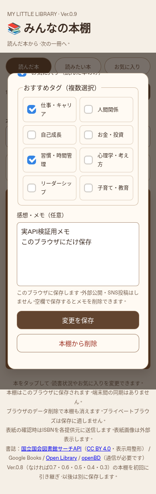

# Ver.0.9 個人用読書管理の改善・検証報告

検証日：2026-11-17。`index-v09.html` を新規追加し、Ver.0.8の検索・一致度順位・ISBN/版と表紙の照合を土台に、個人用の記録機能を追加しました。既存HTMLは変更していません。検索・順位・NDL書誌解析・ISBN照合・表紙取得に関する主要10関数がVer.0.8とバイト単位で同一であることもブラウザ上で比較確認しました。追加課金・秘密のAPIキー・サーバーは不要で、GitHub Pagesで配信できます。

## 追加した操作

- 本の詳細で8種類の固定おすすめタグを複数選択できます。チェックを外して保存すると削除できます。
- 感想・メモを任意で入力・編集できます。空欄にして保存すると削除できます。未入力のまま本を登録できます。タグ・メモは読書状況やお気に入りとは別の項目として保持します。
- 本棚を登録順・タイトル順・お気に入り優先で表示し、並び順も保存します。登録配列自体を並べ替えず、木製本棚と表紙の正面表示を維持しています。
- 「バックアップ・復元」から、全読書データと並び順をJSONファイルとしてダウンロードできます。ファイルにはメモも含みます。ブラウザ内のファイル生成であり、サーバーへのアップロードやSNS投稿は行いません。
- 復元ファイルを選ぶと、形式を検証し、現在と復元後の冊数、読書状況、お気に入り、タグ・メモのある冊数を確認画面に表示します。「この内容で置き換える」を押すまで保存しません。0冊のファイルでも確認を省略しません。

自動同期・クラウド保存・レビュー公開・自由タグの作成・ドラッグ配置は今回の機能に含みません。通常の検索・表紙照会では従来どおり外部APIへキーワードやISBNを送りますが、メモやタグを送信する処理は追加していません。

## データ構造

保存キーは `minna-no-hondana.v09`、アプリの保存形式は `version: 9`。書誌と個人用の情報を分けています。

```json
{
  "version": 9,
  "settings": {"sort": "registered"},
  "books": [{
    "id": "提供元の書誌ID",
    "title": "書名",
    "author": "著者",
    "isbns": [],
    "type": "read",
    "favorite": false,
    "reading": {
      "recommendedTagIds": ["career", "growth"],
      "review": {"text": "非公開メモ", "visibility": "private", "updatedAt": null},
      "placement": {"registrationOrder": 0, "position": null},
      "addedAt": null
    }
  }]
}
```

タグは表示名ではなく安定したIDの配列にし、将来タグ一覧を拡張できる形にしました。今回受け入れるIDは固定8種類です。メモには公開範囲と更新日時を分けた入れ物を設けていますが、現在は `private` だけを受け入れ、公開操作はありません。配置情報には登録順と将来の位置情報用の `position` を分け、今回は位置を `null` に固定しています。追加フィールドを持つ書誌も保持し、ISBNや別言語版を推測で置き換えません。

バックアップは上記データを `format: "minna-no-hondana-backup"`、`schemaVersion: 1`、`exportedAt` とともに包みます。バックアップの形式番号と、アプリの保存形式番号は別です。

## データ保護と復元

初回はVer.0.8、なければ0.7〜0.3から読み取ります。書名・著者・ISBN・言語・表紙・読書状況・お気に入り・追加フィールドを維持し、タグとメモの初期値、登録順を追加します。旧保存キーを削除・上書きせず、最初の編集や並び替え保存からVer.0.9へ別保存します。刊行年が配列で保存されていたOpen Library書誌も、形式を変えず保持します。

復元では以下を確認します。

- JSONの構文、バックアップの識別子・形式番号、アプリ形式番号、必須項目の型。
- 書籍IDの重複、読書状況・お気に入り、ISBNチェック桁、タグIDと重複、メモ・配置・並び順。
- データの大きさ（10MB以下）、冊数（5000冊以下）、メモ（1冊20000文字以下）、過度の入れ子や危険なプロパティ名。

不正な内容は確認画面に進めません。正しいファイルでも、確認前には現在のデータを変更しません。保存時は本と設定を一つのJSONとして `localStorage.setItem` に書き、成功してから画面の本と設定を差し替えます。容量不足などで書けなければ、元の読書データと画面内の状態を保持します。容量不足時に削除するのはVer.0.9の任意の検索・表紙キャッシュだけで、旧保存キーや読書データを削除しません。

プレビュー後に保存データが別の画面で変更された場合は、ファイルの選び直しを求めます。これは端末間同期の実装ではありません。旧データの検証は画面の本に割り当てる前に行い、壊れた旧データでも復元操作を使える状態に保ちます。壊れたVer.0.9の保存データがある場合も、自動で削除せず、検証済みバックアップの明示的な復元で回復できます。復元内容の書誌が実物と一致するかを外部照合したり、ファイルの真正性を証明したりする機能ではありません。

## 模擬API・ローカルファイルによる自動テスト

Chromium（390×844、810×1080、320×700、1440×900）とiPhone/iPad相当のLinux WebKitを使用しました。検索・表紙APIと画像は模擬応答です。個人用記録の検証では外部通信を遮断しています。68項目×6構成、408ケースすべて成功（5.3分）。

- タグの複数追加・削除・再読み込み、メモの新規入力・編集・削除と安全な文字表示。
- メモを保ったままの読書状況・お気に入り変更、3種類の並び順と設定保持、登録配列が変わらないこと。
- JSONダウンロードの発生、実ファイルのJSON構文と全データの一致、そのファイルからの復元。
- 上書き前の確認、キャンセルと同じファイルの再選択、0冊の復元。
- 破損JSON、別形式・将来バージョン、重複ID、不正ISBN・タグ・メモ・読書状況・配置・並び順、危険なプロパティ名を含むファイルの拒否。
- ファイル読み取りエラー・大きすぎるファイル・保存容量不足・プレビュー後の保存変更で、既存データを保持すること。
- Ver.0.8からの引き継ぎと旧キーのバイト列の保持。お気に入り、読みたい本、配列形式の刊行年、独自の追加情報も対象です。
- Ver.0.8由来の日本語検索・順位・ページ追加と選択保持・ISBN/表紙照合・429/時間切れ・一括登録・お気に入り・保存の回帰テスト。
- 端末サイズ別のタグ・メモ・保存ボタン操作、ダイアログ・入力欄の横はみ出しがないこと。

キャンセル直後の再選択で、前のダイアログ終了イベントが新しい復元処理を無効にする問題をテストで見つけました。キャンセル状態を同期的に破棄するよう修正し、再検証しています。

## 実API検証（上記の模擬APIと分離）

Linux WebKit、390×844で、Pagesと同じHTTPSオリジンのURLにHTMLだけをローカル供給しました。NDL・openBD・Open Library・GoogleのAPI/JSONP/画像は差し替えていません。実際のGitHub Pages公開の検証ではありません。

『エッセンシャル思考』を検索して日本語4候補を取得（約1.975秒）。ISBN `9784761270438` の日本語版を選び、Google経由の128×185の実画像をDOMでデコード・表示しました。

その実APIの書誌を一括登録の操作から登録し、タグ「仕事・キャリア」「習慣・時間管理」、非公開のテスト用メモ、お気に入り、並び順を保存しました。JSONを実際にダウンロードし、一度メモを書き換えた後、ダウンロードしたファイルを確認付きで復元しました。再読み込み後の本・個人用記録・設定がバックアップ内のデータに完全一致することをassertで確認しました。

実通信・書誌・復元結果は `V09-live-results.json`、再実行スクリプトは `tests/v09.live.cjs` です。実API検証の対象書籍は今回この1冊で、すべてのタイトルや全サービスの可用性を再確認したという意味ではありません。表示時間は単回測定で、画像取得・編集・復元の時間は含みません。

### WebKitの記録編集画面

JSONから復元した後のテスト用タグとメモです。利用者の実データは使用していません。



## 未検証・制約

- iPhone/iPad実機Safari、実機の「ファイル」アプリへの保存とファイル選択は未検証です。Playwright WebKitではダウンロードとファイル選択・復元を確認しましたが、実機のネイティブ保存画面と同じとは扱いません。
- 実際のGitHub Pages配信は未検証。PRは未マージ・レビュー待ちです。
- プライベートブラウズ、ブラウザのデータ消去、端末故障で端末内保存を失う可能性は従来と同じです。JSONは利用者が保存・保管する必要があり、自動同期や自動バックアップではありません。
- 10MB・5000冊・メモ20000文字などの上限を超える内容、将来のバックアップ形式は受け入れません。復元元が現在の対応形式である必要があります。
- NDLの429・タイムアウトや表紙未収録など、Ver.0.8までの外部サービスの制約は残ります。今回検索設計を大きく変更していません。

## 再実行

```sh
npm ci
npx playwright install chromium webkit
npx playwright test --config=playwright.v09.config.cjs
V09_ENGINE=webkit node tests/v09.live.cjs
```

実通信スクリプトはリポジトリ直下で実行し、既定では `test-results/v09-live/` に結果JSON、テスト用バックアップ、画面キャプチャを出力します。今回の管理環境では既存の作業用ブラウザと依存ライブラリを使いました。WebKitの証明書検証無効化は指定していません。
