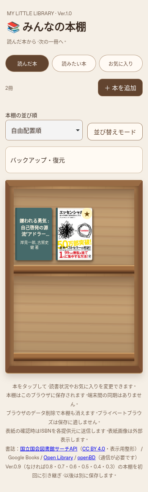
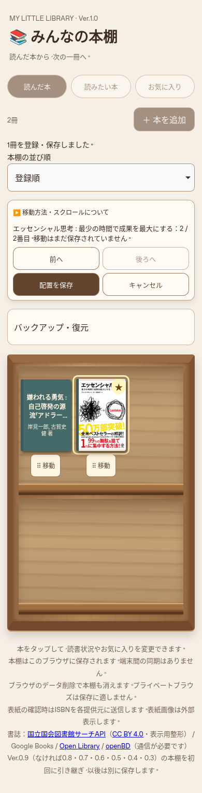

# Ver.1.0 木製本棚・自由配置の実装と検証

検証日：2026-11-18。`index-v10.html` を新規作成しました。既存HTMLとVer.0.9以前の保存キーを変更・削除していません。追加の有料素材・API・秘密のキーは使用しません。検索・読書記録・タグ・メモを土台に、表示と自由配置を追加しています。検索・順位・NDL解析・ISBN照合・表紙の主要10関数はVer.0.9とバイト単位で同一であることも確認しました。

## 木製本棚

木目・背板の陰影・棚板前面・枠の奥行きをCSSの固定グラデーションと影で表現しました。外部の木目画像や常時動く装飾はありません。表紙は正面を向き、画像は `object-fit: contain` で元の縦横比を維持します。未取得時は文字表紙で書名・著者を表示します。

iPhone幅は3列、iPad等の620px以上は4列です。冊数に応じて棚段を追加し、0冊や空き段も背板と棚板の自然な空間を残します。模擬データ0冊・1冊・120冊で段数、横はみ出し、横長画像の非トリミングを検証しました。120冊の検証を、実機の5000冊での性能保証とは扱いません。

## 並び替えモード

通常のタップは従来どおり詳細を開きます。「並び替えモード」は、読んだ本・読みたい本で2冊以上ある場合に開始できます。開始すると自由配置順のプレビューに切り替わりますが、保存済みの並び順設定はまだ変更しません。

- 本の表紙を約400ms長押しして移動できます。専用の「⠿ 移動」ハンドルも用意しました。
- 移動中は元の本を薄くし、指に追従する表紙と、破線の移動先を表示します。指を離すとその位置へ挿入して仮置きします。空いた場所は最も近い本の位置へ対応させます。任意の隙間や座標を固定する配置ではなく、本の順番を編集する機能です。
- 「配置を保存」で確定し、再読み込み後も保持します。保存前の編集は「キャンセル」で全て破棄します。指を離すだけで永続保存したと誤認しないよう、画面にも仮置きと保存を案内しています。
- 本を選んで「前へ」「後ろへ」で移動できます。選択した本にフォーカスがある場合は矢印キーでも移動できます。
- Esc、pointercancel、touchcancel、複数指、画面の非表示等で移動を中止できます。Escは移動中ならその移動だけ、移動中でなければ編集モード全体を取り消します。
- 長押し成立前の表紙上の移動は編集開始を取り消し、通常スクロールを妨げません。成立後のTouch Eventsは `preventDefault` で競合を抑えます。ハンドルは `touch-action: none` の移動専用で、表紙や棚の余白と使い分けます。
- 画面の端へ移動すると自動スクロールします。長押し待機中に実際のスクロール位置が変わった場合は開始を取り消します。遅れて届いたスクロール通知だけで次の長押しを誤って中止しないよう、開始時の位置と比較します。
- Pointer EventsとTouch Eventsを併用し、HTML標準のドラッグ＆ドロップには依存しません。編集中はネイティブ画像ドラッグやコンテキストメニューも抑止します。

編集モードでは本の追加・読書状況タブ・並び順変更・復元等の競合する操作を無効にします。指で別の読書状況へ本を移動させる機能はありません。保存容量不足では元の配置を保持し、編集内容は再試行またはキャンセルできます。別画面で保存内容が変わった場合は上書きせず、キャンセルと再読み込みを案内します。

## 並び順と保存構造

登録順・タイトル順・お気に入り優先を維持し、「自由配置順」を追加しました。自由配置は次の独立したID配列です。以下は主要項目の略記で、そのまま復元に使うJSONではありません。

```json
{
  "version": 10,
  "settings": {"sort": "manual"},
  "manualOrder": {"read": ["書籍ID2", "書籍ID1"], "want": ["書籍ID3"]},
  "books": ["従来と同じ書誌・読書記録のオブジェクト"]
}
```

`books` の登録配列、`reading.placement.registrationOrder`、書誌・表紙・タグ・非公開メモをドラッグで書き換えません。自由配置順を選んだときだけ `manualOrder` を使います。お気に入りには独立した配置を作らず、読んだ本の順序からお気に入りだけを抽出します。お気に入り画面からの配置編集は行わず、読んだ本での編集を案内します。

新規登録は該当状況の末尾へ追加し、削除はIDを除去します。詳細画面で読書状況を変えると、移動前の配列から除き、移動先の末尾へ追加します。既存のID順を維持したうえで、不足分を登録順に追加する整合処理を保存時に行います。復元時は黙って修正せず、重複・欠落・異なる状況のIDがあれば拒否します。

保存キーは `minna-no-hondana.v10`。初回はVer.0.9、なければ0.8〜0.3を読み取り、元キーはそのまま残します。Ver.0.9の書誌・ISBN・表紙情報・読書状況・お気に入り・タグ・メモ・追加フィールドを保持し、初期の自由配置順は登録順から作ります。以後は別の保存データで、自動同期ではありません。

## 新旧バックアップ

| バックアップ | schemaVersion | data.version | 対応 |
| --- | ---: | ---: | --- |
| Ver.0.9のJSON | 1 | 9 | 旧形式として検証し、登録順から自由配置を追加 |
| Ver.1.0のJSON | 2 | 10 | 既存の記録と自由配置の完全性を検証 |

識別子は共通の `minna-no-hondana-backup` です。形式番号とアプリの版が混在するJSONや未対応の将来形式は拒否します。確認画面には元の版を明示します。旧形式を自動で上書きせず、復元確認後にVer.1.0の保存キーへ書き込みます。

Ver.0.9の検証・確認・キャンセル・容量不足時の保護を維持しました。新形式は `read` / `want` の各ID配列が、実際の読書状況と過不足なく一致することも必須です。バックアップには個人用メモも含まれ、端末内のファイルとして利用者が保管します。10MiB、5000冊、メモ1冊20000文字等の既存上限は維持します。

## 自動テスト：模擬API・模擬書誌

Chromium（390×844、810×1080、320×700、1440×900）とLinux WebKit（iPhone相当390×664、iPad相当810×1080）で実施します。最終構成は94項目×6構成、重複を除いて564ケースすべて成功です。全体558ケース（9.0分）の完了後、文字表紙の著者欄の視認性を調整し、新しい確認を含む配置156ケースを再実行して全て成功しました（2.9分）。APIと画像は模擬応答で、配置テストの書誌はテスト用です。

- Ver.0.9由来68項目：日本語検索・適合度順位・追加ページと選択保持・ISBNと表紙・429/時間切れ・複数登録・読書状況・お気に入り・タグ・メモ・3種類の並び替え・JSONと不正ファイル・容量不足・移行を回帰検証。
- 配置・表示26項目：独立した登録順と自由順、読んだ/読みたい別配置、お気に入りの抽出、前後ボタン、矢印キー、保存と再読み込み、キャンセル、追加・削除・状況変更、容量不足、他画面での保存変更、新旧JSONと不整合配列の拒否、0/1/120冊の表示、長い文字表紙で著者欄が見切れないこと。
- ドラッグ：ブラウザのマウス長押し、移動中の表示・移動先、ドロップ、自動スクロールとEscを検証。
- タッチ：タッチ対応コンテキストのPlaywright `touchscreen.tap` で実際のタップ入力を検証。長押し・移動・解除・複数指・キャンセルは合成したtouchstart/move/end等の列とPointerEventでも検証しました。WebKitではTouchコンストラクターが使えないため、touch情報を付けた合成イベントでアプリの分岐を通しています。
- 別途ChromiumのCDPタッチ入力でも、長押しが成立し、移動先r2が選ばれ、ドロップ後の順がr1・r2・r0となることを観測しました。

合成イベントはiPhone実機のネイティブ長押し・慣性スクロール・OSのジェスチャー競合を完全再現しません。これらを実機合格とは数えません。小画面の操作テストは、対象の本を可視領域へスクロールしてから実施し、画像はデコード完了後に縦横比を確認しています。

## 実API検証：上記と分離

Linux WebKit、390×844で、Pagesと同じHTTPSオリジンにHTMLだけをローカル供給しました。NDL・openBD・Open Library・GoogleのAPI/JSONP/画像は差し替えていません。実際のPagesへ配信したという意味ではありません。

最終確認では『エッセンシャル思考』を日本語タイトルで検索し、4件を約1.315秒で表示。ISBN `9784761270438` のGoogle画像128×185をデコードしました。2冊目はISBN `9784478025819` で『嫌われる勇気』を1件、約0.547秒で取得しました。

この2冊を登録し、移動ボタンで『嫌われる勇気』→『エッセンシャル思考』の自由配置へ変更して保存しました。タグ・メモ・お気に入りも保存し、配置を含むJSONをダウンロード後、一度メモを変更してから確認付きで復元しました。再読み込み後の全データがバックアップと一致し、自由配置順も維持されることをassertで確認しました。復元後の本棚上でも『エッセンシャル思考』の実画像128×185が描画完了したことを確認しています。

先行するタイトル検索の検証では、『エッセンシャル思考』は4件・約1.479秒でしたが、『嫌われる勇気』のタイトル照会はNDL12秒時間切れで0件（約13.498秒）でした。その回に確認できたのは1冊の記録・JSON復元のみで、2冊の配置成功とは数えません。後のISBN照会成功と分けて `V10-live-results.json` に保存します。『嫌われる勇気』の実表紙成功を示す検証でもありません。

実API書誌での配置操作は移動ボタンです。実API書誌をiPhone実機で指ドラッグしたという意味ではありません。今回の主眼は配置とデータ保護で、全書籍・全検索先の可用性を再検証したものではありません。速度は単回測定で、画像取得や編集時間は含みません。

## 実APIの書誌での画面キャプチャ

配置・JSON復元後の本棚。書影が得られた本と文字表紙の本を区別して表示しています。



移動ボタンで仮置きした編集画面。ここでは長押しドラッグではなく、移動ボタンを使っています。



## 未検証・残る制約

- iPhone/iPad実機Safariでの長押し、指ドラッグ、慣性スクロール、ピンチ、端末回転時の操作、OSメニューとの競合は未検証です。専用ハンドルと移動ボタンも用意していますが、実機で確実に動作したとは断定しません。
- 実機「ファイル」アプリと実際のGitHub Pages配信は今回未検証です。PRは未マージです。
- 保存前の仮配置は再読み込みや終了で失われます。画面上で「配置を保存」する必要があります。自動同期・ドラッグによる読書状況変更・任意座標や空き枠を残す配置は実装していません。
- 外部検索の429・時間切れ・表紙未収録は従来どおり起こります。失敗したタイトル検索を成功とは扱わず、ISBNで取得できた事実と区別しました。
- 120冊の模擬データ検証は、実機での大量画像の速度やメモリ消費の保証ではありません。常時アニメーションを使わず、ドラッグ中だけ描画処理を動かしています。

## 再実行

```sh
npm ci
npx playwright install chromium webkit
npx playwright test --config=playwright.v10.config.cjs --workers=2
V10_ENGINE=webkit V10_SECOND_ISBN=1 node tests/v10.live.cjs
```

実通信スクリプトはリポジトリ直下で実行し、既定では `test-results/v10-live/` にJSON・テスト用バックアップ・画面キャプチャを出力します。`V10_SECOND_ISBN` を省略すると2冊目も書名で検索し、結果を記録します。2冊目が得られない場合に1冊の復元が成功しても、実API2冊の配置成功とは意味しません。`secondSearch.found` と `manualInteraction` も確認してください。今回の管理環境では既存のブラウザ依存ライブラリを使用し、WebKitの証明書検証は無効化していません。
