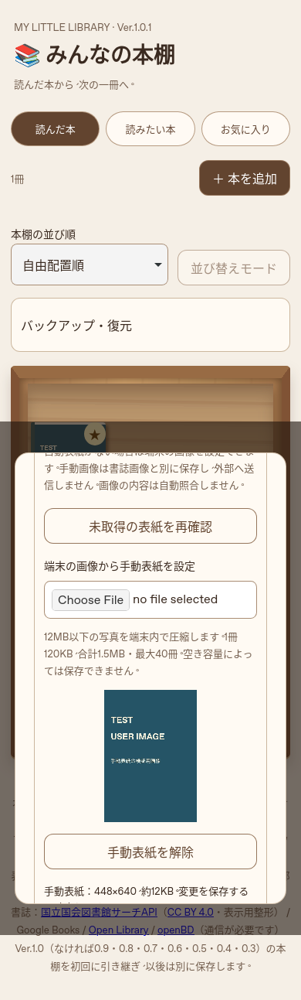
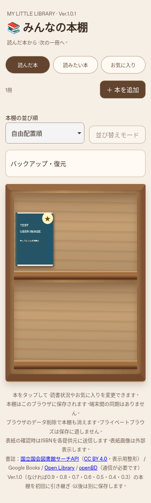

# Ver.1.0.1 表紙・検索入力の改善と検証

検証日：2026-11-18。`index-v101.html` を追加し、旧HTMLと旧保存キーを変更・削除していません。追加の有料契約・秘密のAPIキーは不要です。

## 対象書籍の調査：事実と制約

『苦しかったときの話をしようか』は、ISBN **9784478107829**、森岡毅著、ダイヤモンド社、2019年4月の書誌をNDL/openBDの実応答で確認しました。主書名に加え、副題は「ビジネスマンの父が我が子のために書きためた『働くことの本質』」。ISBN10は4478107823です。版表示自体が取得できない箇所は、版数を推測していません。

| 検索先・照会 | 今回の実応答 | 判定 |
| --- | --- | --- |
| openBD・同ISBN | 書名・著者・出版社は一致、summary.coverが空 | 書誌あり・画像URL未提供 |
| Open Library Books API・同ISBN | `{}` | 同ISBNの書誌回答なし。サービス全体に本が存在しないとまでは断定しない |
| Open Library Cover API・同ISBN、default=false | HTTP404 | 同ISBNの画像を取得できず |
| Google Books Dynamic Links・ISBN13/10 | 同じvolume ID `IesfxQEACAAJ` の書誌リンク、thumbnail_urlなし | 同ISBNの画像URL未提供 |
| Google Books Volumes API・同ISBN | HTTP429、Queries per dayのクオータ超過 | 無認証リクエストのサービス制限。書影の有無の証明ではない |
| Googleの同volume ID画像への補助調査 | HTTP200だが「image not available」の画像 | 実表紙の成功とは数えない |

対象書籍の文字表紙は、今回確認できた範囲では**既存サービスから同ISBNの書影URLを取得できなかったこと**で説明できます。世界中のサービスに画像が存在しないと証明したものではありません。別ISBN・別言語の表紙で代用しません。この補助調査のURLを生成して、プレースホルダーを実表紙として採用する処理は追加していません。

先行するNDLタイトル照会には429も発生しました。後のISBN照会では日本語の書誌を取得できています。実機で症状が起きた時点の通信記録はないため、全ての文字表紙を同一の原因と断定していません。

## 自動表紙の改善

- openBDで「同ISBNの書誌回答なし」「ISBN不一致」「書名本体不一致」「画像欄が空」を区別して診断します。
- Open LibraryでISBN照合情報、書名本体、版ID、出典URL、画像URLを確認し、不一致の理由を分けます。出典URLも同じ版を指す必要があります。
- Google Dynamic LinksのISBN・volume ID・画像/書誌URLの整合性を維持し、画像URL未提供と不整合を分けます。
- 許可した同じホストのHTTP URLはHTTPSへ正規化できます。画像/書誌IDやホストの照合は省略しません。この改善は模擬APIで検証しており、対象書籍の未提供画像を取得できたという意味ではありません。
- 書名本体は既存の正規化で比較し、コロンと副題の空白表記差だけで、同ISBN・同主書名の画像を拒否しないようにしました。
- 本の詳細に「未取得の表紙を再確認」を追加。30秒間隔・提供元の休止時間を守り、未取得分を再照会します。取得済みの画像は消してやり直しません。
- 旧版の確認済み表紙URLキャッシュも読み取り、空の新キャッシュに隠れないよう統合します。ISBNとキー・寸法の証拠を確認し、期限を過ぎただけで取得済み画像を文字表紙へ戻しません。実際の画像読み込みに失敗すれば再照会し、取得できなければ文字表紙を維持します。
- 再確認結果の到着で、手動画像ファイルの検証エラー表示が消されないようにしました。

診断は従来どおり任意で開く確認用表示です。通常画面には、表紙を確認できたか、文字表紙を維持するかを簡潔に表示します。ISBN不一致等の分岐は模擬応答で検証し、対象書籍の実応答にISBN不一致があったとは報告していません。

## 手動表紙：元画像と別の端末内データ

本の詳細の「表紙画像」から端末の画像を選択し、「変更を保存」で確定できます。元の `book.image` や書誌の版情報は書き換えず、`reading.coverOverride` に `kind: device`、書籍ID、JPEG、寸法、バイト数、更新日時、画像データを保存します。表示には「手動表紙（端末の画像・書誌照合なし）」を明示し、画像の内容が本当にその本の表紙かを自動判定したとは扱いません。

- 入力は12MiB以下。JPEG・PNG・WebP等を読み取り、長辺640px以下・縦横比維持のJPEGへ端末内で圧縮します。SVGは受け入れません。HEIC/HEIF/AVIFはブラウザが読み取れる場合に限ります。
- 1冊120KiB以下、手動画像合計1.5MiB以下・最大40冊。元ファイルそのものは保存しません。デコード画像は4000万画素・一辺16000px以下とし、極端な縦横比は歪ませず拒否します。
- Base64と既存データも保存容量を使うため、上限内でもブラウザの空き容量次第で保存が失敗します。その場合は元の本・元画像・メモ・配置と保存データを保持します。旧キーを削除して容量を空ける処理はありません。
- 保存前に閉じれば変更を破棄します。「手動表紙を解除」も保存して初めて確定し、元の自動表紙または文字表紙へ戻ります。
- 手動画像を選択中は保存ボタンを無効にし、閉じる・別の画像を選ぶ等で古い非同期処理が後から別の本を上書きしないよう制御します。
- 画像を外部サービスにアップロードしません。手動表紙を設定した本の再描画で、新たな自動表紙照会を発生させません。

## 検索入力の初期化

Ver.1.0は登録後に結果・選択を消していましたが、`query.value` をクリアせず、次回の開く操作もダイアログ表示だけでした。これが前回の入力が残る直接のコード経路です。

登録が成功した場合にキーワード・著者入力・結果・選択・ページ状態を初期化します。新たに「＋ 本を追加」で開くとき、および「閉じる」やEscでキャンセルしたときも初期化します。一方、検索途中・選択途中・検索失敗・保存失敗では入力や選択を維持します。

検索先・検索対象の種類・言語を含める設定は維持します。著者欄は検索語なので新しいセッションでは空にします。新規に開くクリック内で入力欄へフォーカスし、16pxの入力文字と既存のiPhone向けダイアログ構成を維持します。前のダイアログの遅延したcloseイベントが、新しく開いた検索を中止しないようにしています。

## 保存・移行・バックアップ

保存キーは `minna-no-hondana.v101`、保存データの `version` は101、バックアップは `schemaVersion: 3` です。Ver.1.0のキーは読み取って別保存し、0.9以前からの移行も維持します。書誌、読書状況、お気に入り、タグ、メモ、自由配置を保ちます。

| バックアップ | schemaVersion / data.version | 読み込み |
| --- | --- | --- |
| Ver.0.9 | 1 / 9 | 対応、自由配置を登録順から補完 |
| Ver.1.0 | 2 / 10 | 対応、自由配置を保持 |
| Ver.1.0.1 | 3 / 101 | 対応、手動画像も含めて保持 |

形式の不一致、手動表紙の書籍ID不一致、JPEGの形式・容量・枚数・寸法などを検証します。手動画像は復元の確認画面に進む前に実際にデコードし、寸法も照合します。破損画像を含む復元、容量不足では現在の保存を変更しません。既存の復元確認・キャンセル・他画面での変更検知も維持します。復元成功時は古い詳細編集の下書きも終了し、復元後の手動画像を古い編集状態で上書きしないようにしています。

ファイルの生成・復元は利用者の操作による端末内処理であり、自動同期やレビュー公開ではありません。

## 自動テスト：模擬APIとテスト画像

Chromium（390×844、810×1080、320×700、1440×900）およびLinux WebKit（iPhone相当390×664、iPad相当810×1080）を使用します。重複を除き112項目×6構成、672ケースが対象です。全体実行後に見つかった表紙通知・旧キャッシュの問題を修正し、関連114ケースを再実行して全成功（2.0分）。その後の全体再実行は671成功・1不成立（10.7分）でした。不成立はiPhone相当WebKitの長押し中自動スクロールで、同一の試験を単独で3回再実行し全成功しました（24.6秒）。並列ブラウザのフォーカス干渉の可能性がありますが、原因を断定していません。入力を保持する試験への影響を避けるため、既定は1ワーカーにしています。最終版の全体を一度の実行で無失敗完了したとは報告していません。

Ver.1.0由来94項目に、改善18項目を追加しました。登録後の空欄と次の検索、キャンセルと検索設定維持、検索/保存失敗時の語と選択の保持、遅延close、HTTP表紙URLの正規化、診断、旧画像維持、既存本の再照会、手動画像の圧縮・保存・再読み込み・解除・キャンセル・JSON往復・容量不足・不正画像・別書籍/合計容量の拒否を検証します。自由配置の保存/キャンセル、日本語検索・順位、ISBN/版、複数登録、タグ・メモ・お気に入り、新旧JSONも回帰対象です。

テストで、遅れて届いた自動表紙通知がファイルエラー表示を消す問題、空の新キャッシュが旧画像を隠す問題を見つけて修正しました。旧データ破損テストでは、意図的な通信遮断がWebKitのCORSエラー通知として混ざったため、個人記録テストのAPI応答を管理された空の模擬応答へ変更しました。実サービスが正常だったという意味ではありません。

手動画像の検証には生成したPNG/JPEGを使用しています。実際の書影として取得できた画像とは区別しています。ドラッグのWebKit長押し等についてはVer.1.0同様にマウスと合成イベント列を含み、実機の指操作を保証するものではありません。

## 実API検証：上記の模擬APIと分離

`tests/v101.live.cjs` で、Linux WebKit・390×664、Pagesと同じHTTPSオリジンへHTMLだけをローカル供給して検証します。API・JSONP・自動画像は実通信です。今回は対象書籍をISBNで取得し、実APIの書誌をVer.1.0形式のテスト用読書データとして構成して移行も確認しました。利用者の実データは使っていません。

最終の実通信では、9784478107829の日本語書誌を1件・約1.249秒で取得しました。登録成功後と次回の開く操作で検索語が空になることもassertで確認しました。既存本の自動表紙は取得できず、診断は冒頭のサービス別結果と同じでした。生成した「TEST USER IMAGE」を手動で選び、448×640・約12KBのJPEGへ圧縮し、保存・再読み込み・JSON書き出し・解除・確認付き復元を実行しました。復元後の全データ一致、手動画像のデコード、元のVer.1.0キーが変わらないことをassertで確認しました。

この回の追加検証『エッセンシャル思考』のISBN検索はNDL429等で取得できませんでした（約1.112秒）。この回を、実API2冊の登録や自動表紙維持の成功とは数えません。取得済み画像の維持は旧キャッシュと元画像を使った模擬テストと区別しています。

画像の内容は検証用の生成画像であり、対象書籍の正しい書影を自動取得できたとは意味しません。実通信と確認した範囲は `V101-live-results.json` に記録します。今回の検索速度は単回測定で、圧縮や復元の時間は含みません。

## 手動表紙の画面例

手動画像は「TEST USER IMAGE」と明記した生成画像です。対象書籍の正しい実表紙として取得した画像ではありません。





## 未検証・残る制約

- 並列実行では長押し中自動スクロールの1試験が不成立でした。単独3回は成功し、実行環境の影響が考えられますが、実機動作の保証ではありません。
- iPhone/iPad実機Safari、実機の写真選択・「ファイル」アプリ、実際のGitHub Pages配信は未検証です。HEIC、EXIF回転、大量の写真、OSのネイティブ保存画面も実機未検証です。
- 対象書籍の実表紙は今回の既存サービスから取得できていません。出版社等の他サービスに存在しないと断定せず、ユーザーが端末の画像を設定する代替操作を用意しています。
- 旧版は新バックアップ形式3を理解しません。Ver.1.0.1の手動画像を含むJSONはVer.1.0.1へ復元してください。新画面は旧形式1/2も受け入れます。
- 容量や対応画像形式には上限があります。上限内でも旧キー等との共通の保存容量が不足する場合があります。旧データを自動削除して空けません。
- NDL429・タイムアウト、Google Volumesのクオータ、表紙未提供等の外部制約は残ります。実API検証で未取得だった本を成功とは報告していません。

## 再実行

```sh
npm ci
npx playwright install chromium webkit
npx playwright test --config=playwright.v101.config.cjs --workers=1
node tests/v101.live.cjs
```

実通信スクリプトはリポジトリ直下から実行し、既定では `test-results/v101-live/` へ結果JSONと画面キャプチャを出力します。新しく起動した隔離テストプロファイルだけを使い、移行検証のためそのプロファイル内のVer.1.0.1テスト保存をリセットします。利用者のブラウザ保存を削除する処理を製品に加えたものではありません。`checks.passed` だけで全ての書籍検索に成功したと判断せず、各検索と画像の結果を確認してください。
