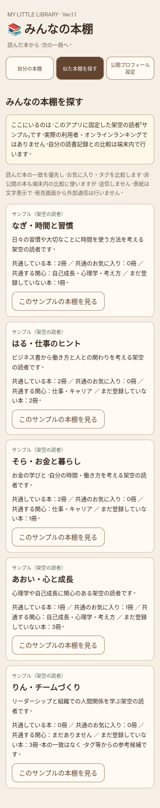
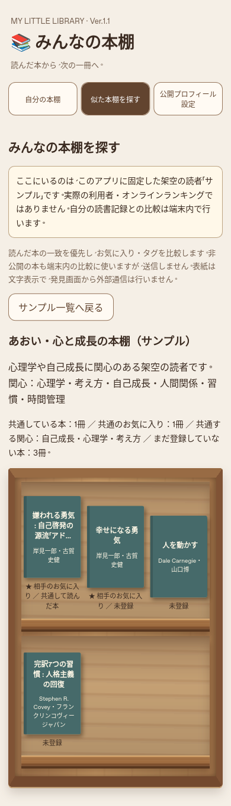
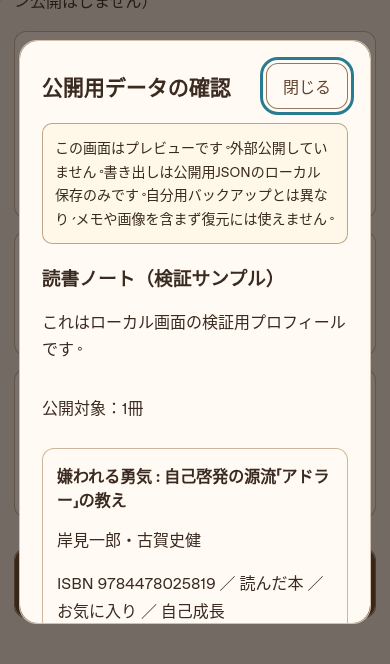

# Ver.1.1 ローカルのプロフィール・本棚発見

設計・検証日：2026-11-19。`index-v11.html` を追加し、Ver.1.0.1から引き継ぐローカル版を作成しました。実利用者との共有、認証、サーバー、クラウドDB、課金サービスはありません。GitHub Pagesで配信できる単一HTMLです。PRは未マージでレビューを待ちます。

## 画面と利用範囲

「自分の本棚」「似た本棚を探す」「公開プロフィール設定」を切り替えます。木製本棚、正面の表紙、読んだ本・読みたい本・お気に入り、検索、手動表紙、並び替えを継承しました。配置編集中は画面移動を無効にし、保存かキャンセルを先に行います。

発見画面の5人は固定した**架空の読者・サンプル**です。実際の利用者やオンラインランキングを表示していません。プロフィールの保存・プレビュー・公開用JSONの保存で、オンライン公開されることはありません。新しい発見・プロフィール操作は外部通信を行いません。従来の自分の本棚の書誌検索・自動表紙照会は別で、検索語やISBNを提供元へ送信する既存機能です。

## 公開設定と許可リスト

保存データには非公開メモや手動画像を含むため、公開データの作成で保存オブジェクト全体をコピーし、後から削除する処理は使用していません。`buildPublicDocument()` が、許可済みの本について次の項目だけを新規オブジェクトへ組み立てます。

```json
{
  "format": "minna-no-hondana-public-profile",
  "schemaVersion": 1,
  "profile": {"nickname": "明示的に承認した名前", "bio": "承認した紹介文"},
  "books": [{
    "title": "書名", "author": "著者名", "isbns": [],
    "status": "read", "favorite": false, "recommendedTagIds": []
  }]
}
```

- プロフィール・本・タグの承認は独立しています。初期プロフィールは空で未承認、本は全件非公開、公開するタグも空です。ニックネームは必須・40文字以内、紹介は任意・500文字以内です。
- 入力・保存だけでは公開しません。名前・紹介文を公開用データに含めるチェックを明示的に選び、保存して初めてプレビューできます。入力途中のプロフィールは書き出しに使用しません。
- 本の公開チェックは1冊ずつ保存します。公開本でも、おすすめタグはさらに個別に選んだものだけ含めます。タグを私用記録から外す、本を非公開に戻す、削除すると、対応する公開承認を解除します。再追加・新規登録した本・タグは自動承認しません。
- 公開用JSONには、メモ・レビュー本文、手動表紙・Base64、自動表紙URL、出版社等の追加書誌、内部ID、配置・設定、端末情報、非公開本のタイトル・ISBN・IDを含めません。元の書籍オブジェクトをネストして含めることもありません。
- プレビューには公開対象の冊数と内容を表示します。確認後の「公開用JSONを端末に保存」でBlobを生成してローカルにダウンロードするだけです。アップロード、URL共有、SNS投稿、公開JSONの読み込みは実装していません。
- 保存後に公開対象が変わったプレビューからは書き出せません。別画面の変更で保存内容が変わっている場合も、再読み込みと再確認を求めます。別タブの承認取り消しを古い画面で上書きしないよう、保存前にも読み込み時のスナップショットと照合します。
- 非公開へ戻しても、すでに端末へ保存した公開用JSONを自動回収・削除することはできません。必要なら古いファイルを自分で削除し、最新の設定で作り直してください。
- 本文表示には`textContent`等を使い、紹介文・書名をHTMLとして実行しません。ローカル保存・自分用バックアップは暗号化された共有保管庫ではなく、利用者がファイルを第三者へ渡せばその内容を読めます。

## 保存・移行・復元

Ver.1.1の保存キーは `minna-no-hondana.v11`、保存データ版は `11`。読書記録に加え、次を独立した`sharing`へ保存します。

```text
sharing.profile = { nickname, bio, approved }
sharing.books[ローカル書籍ID] = { visible, tagIds }
```

IDは端末内の公開設定との関連付けにだけ使用し、公開用JSONには出しません。設定が存在しない本は非公開です。旧形式に未知の公開設定が紛れていても承認として採用しません。旧データの書誌・手動表紙・読書状況・お気に入り・タグ・メモ・自由配置は保持します。

| 種類 | 識別子 | schemaVersion / data.version | 用途 |
| --- | --- | --- | --- |
| Ver.1.1 自分用バックアップ | `minna-no-hondana-backup` | 4 / 11 | 全読書データ・手動画像・配置・公開設定の確認付き復元 |
| Ver.1.0.1 自分用バックアップ | 同上 | 3 / 101 | 読み込み対応。公開設定はすべて非公開へ初期化 |
| Ver.1.0 自分用バックアップ | 同上 | 2 / 10 | 読み込み対応。公開設定はすべて非公開へ初期化 |
| Ver.0.9 自分用バックアップ | 同上 | 1 / 9 | 読み込み対応。自由配置を補完、すべて非公開 |
| 公開用JSON | `minna-no-hondana-public-profile` | 1 / dataなし | ローカル生成のみ。読書データの復元には使えない |

旧HTML・旧保存キーは書き換え・削除しません。Ver.1.0.1、1.0、0.9以下の順で既存データを読み取り、初めて変更を保存すると新キーへ書き込みます。旧版の確認済み表紙キャッシュとVer.1.0.1のAPI休止時刻も読み取ります。容量不足時に整理するのは新しい版の任意キャッシュだけです。

新旧バックアップは識別子・版・書誌・ISBN・手動JPEG・画像寸法・配置・公開設定を検証し、確認前には置き換えません。公開用JSONをバックアップとして渡した場合、ファイル名を変更した場合やバックアップ識別子だけ付け直した場合も、データ形式の検証で拒否します。容量不足・保存失敗では記録と設定のメモリ上の確定も行わず、保存済みデータを保持します。復元中の別画面の変更も検出します。新形式4は旧版アプリでは復元できません。

## サンプルの書誌確認

2026-11-19にopenBDの実API応答で、採用した8冊のタイトル・著者・ISBNを確認しました。元の回答と照会URLは [sample-bibliography.json](docs/v11/sample-bibliography.json) に記録しています。未回答のISBN候補はサンプルに採用していません。著者の表示では元回答の姓名のカンマ・生年を除いたり、同じ著者名を読みやすく表記しています。役割を推測した著・訳の区分や、未確認の版番号は追加していません。

| 書名 | 確認したISBN |
| --- | --- |
| 嫌われる勇気 : 自己啓発の源流「アドラー」の教え | 9784478025819 |
| エッセンシャル思考 : 最少の時間で成果を最大にする | 9784761270438 |
| 人を動かす | 9784422100517 |
| 完訳7つの習慣 : 人格主義の回復 | 9784863940246 |
| 苦しかったときの話をしようか : ビジネスマンの父が我が子のために書きためた「働くことの本質」 | 9784478107829 |
| 幸せになる勇気 | 9784478066119 |
| 本当の自由を手に入れるお金の大学 | 9784023318786 |
| もし高校野球の女子マネージャーがドラッカーの『マネジメント』を読んだら | 9784478012031 |

5人のテーマは「仕事」「心と成長」「お金と暮らし」「チームづくり」「時間と習慣」。読者名・紹介・選書・お気に入り・タグは架空の編集データです。openBDが実利用者の好みを提供したわけではありません。8冊とも今回のsummary.coverは空でした。サンプル棚は外部照会をせず、タイトルと著者を正面の文字表紙で表示します。実表紙を取得できたとは報告しません。自分の本棚の既存自動・手動表紙は引き続き使用できます。

## 読書傾向の比較方法

比較対象は、自分の**読んだ本**と、サンプルの読んだ本です。非公開の本や私用タグも端末内の比較にのみ使用します。公開プロフィールを作る必要はありません。読みたい本は傾向の集計に含めませんが、未登録判定からは除きます。

1. 有効なISBN10は同じISBN13へ変換し、一致すれば同じ本とします。両方に有効なISBNがあり、一致がなければ書名が同じでも別の版として扱います。内部IDや作品IDの一致だけで同じ本にしません。
2. 少なくとも片方にISBNがない場合、NFKC・大文字小文字・連続空白を正規化した**書名全文と著者名の両方が完全一致**するときだけ補完します。副題・巻名・句読点は落としません。著者不明・既知の異なる言語は一致させません。表記差による見逃しはあり得ますが、関連書籍を同一扱いしない方を優先します。
3. 同じ本の重複記録で一致冊数を水増ししません。共通して読んだ本の冊数、双方がその本をお気に入りにしている冊数、おすすめタグの集合の共通要素を計算します。タグの頻度や重複は加点しません。
4. 順位は **共通の本の冊数 → 共通のお気に入りの冊数 → 共通タグの種類数** の辞書順です。同順位なら固定のサンプル順にします。何個タグが一致しても、本が多く一致する候補を追い越しません。表紙の有無は計算に使いません。
5. 一致本0冊でもタグの共通点や参考サンプルを表示します。読んだ本が3冊未満なら「記録が少ないため参考候補」、一致本0冊なら本の一致がないことを明示します。パーセンテージ、人気順、架空の評価数は表示しません。

表示する根拠は共通の本・共通のお気に入り・共通する関心・未登録本の実数です。サンプル棚では共通して読んだ本、登録済み、未登録、相手のお気に入りを区別します。

未登録本の追加では、固定カタログの書名・著者・ISBNの組み合わせとチェック桁を照合し、自分の読んだ本・読みたい本の両方に対して重複確認します。追加オブジェクトは必要な書誌だけで新規作成し、「読みたい本」、お気に入りfalse、タグ・メモ空、公開設定なしで保存します。追加操作でAPI照会を要求せず、サンプル本人のタグ等を私用記録へコピーしません。

## 自動テスト

`tests/v11-discovery.test.cjs` は新機能42項目、`tests/v11-regression*.test.cjs` はVer.1.0.1の112項目を新画面・新キー・バックアップ形式の期待値へ合わせた回帰試験です。旧テストファイルは変更しません。

```sh
npm ci
npx playwright install chromium webkit
npx playwright test --config=playwright.v11.config.cjs --workers=1
```

対象はChromiumの390×844、810×1080、320×700、1440×900と、iPhone相当WebKitの390×664、iPad相当WebKitの810×1080。計154項目×6構成＝924ケースです。検索・表紙は模擬API、手動画像はテスト生成JPEGであり、実APIや実機確認とは区別します。

プライバシー試験はメモ、レビュー、端末風追加フィールド、内部設定、公開本の内部ID、非公開本のID・書名へ別々のCANARY文字列を埋め込み、公開用JSON**全体**に一切ないことを確認します。非公開本のISBN、data:image、Base64、実際の手動JPEG文字列も除外を確認し、出力の全キーを許可リストと比較します。未承認タグの除外・承認の解除・新規本の非公開・別画面の取り消し・公開JSONの復元拒否も含みます。

公開プロフィールの保存からプレビュー、JSONダウンロード、サンプルの発見・追加まで、外部通信が0件であることを実際のブラウザrequestイベントで検証します。この試験は生成手動画像のある隔離プロファイルで行い、既存の自動表紙機能のISBN照会まで通信不要と主張するものではありません。

最終集計と予備実行で検出した問題は、以下の実行記録に記載します。

## 未検証・残る制約

- 実際のiPhone/iPad Safari、写真・「ファイル」アプリ、GitHub Pagesの公開配信は未検証です。端末相当のLinux WebKit試験は実機の代わりではありません。
- ローカルデータ・ファイルの生成までです。実利用者の検索、公開URL、端末間同期、ログイン、クラウド保存はありません。
- サンプルは5人・書籍8冊の固定集合です。実在する人の傾向・人気・推薦効果を検証したものではありません。
- ISBNのない書誌の厳密な書名・著者照合では表記揺れを取りこぼします。ISBNが違う版は意図的に別の本として扱います。
- 公開用JSONに画像は含めません。サンプル棚は文字表紙であり、自分の本棚の手動表紙を相手の表紙へ流用しません。
- 従来の外部検索・表紙サービスの429、タイムアウト、未収録・画像未提供、端末内の保存容量上限は残ります。

## 実行記録・追加確認

### 予備検証と検出した問題

- 初回Chromium予備検証：149成功・1失敗（1.8分）。容量不足でチェックを元へ戻す正しい挙動に対し、テストの`check()`がチェック済みになるまで待っていました。クリック後に未チェック・元データ維持を検証するよう修正し、関連するiPhone相当WebKitの19ケースは全成功（38.8秒）でした。
- 最初の全体実行：**923成功・1失敗（19.8分）**。iPhone相当WebKitの通常タップ試験で、詳細が開かない失敗を確認しました。追加ナビゲーションで最初の本の中央がY=718.35pxとなり、高さ664pxの画面外へテストが座標タップしていました。画面内へスクロールしてタップした実測では詳細が開きました。
- 当該試験を、実際の操作と同じく本を画面内へスクロールしてからタップするよう修正し、座標が画面内であることも検証します。タイムアウト延長やテスト除外ではありません。関連するタップと順位試験をiPhone相当WebKitで3反復し、6ケース全成功（21.4秒）。本の一致がある候補が、タグだけ一致する候補より上位になる検証も強化しました。
- このタップ修正に製品コードの変更はありません。全体結果を見落とした途中報告は訂正し、最終結果を改めて確認します。

### 実APIとPages相当HTTPSオリジンでのWebKit確認

`tests/v11.live.cjs` は通常の模擬API試験から独立した任意実行です。

```sh
node tests/v11.live.cjs
# 成果物を docs/v11 に置く場合
V11_OUTPUT_DIR=docs/v11 node tests/v11.live.cjs
```

新しい隔離ブラウザだけを使います。Pagesと同じHTTPS URLのHTML応答をローカルのビルドに差し替え、そのページからの書誌API通信は実通信で確認します。**実際のGitHub Pagesへ配信したという意味ではありません。** 画面キャプチャの段階は固定書誌と架空のローカルプロフィールを用い、APIを遮断した表示確認です。その後、別の空のブラウザプロファイルで実検索を行います。

今回の実検索「エッセンシャル思考」は約13.338秒で採用結果0件でした。NDLは12秒のタイムアウト、Open LibraryはHTTP200でしたがアプリで採用する結果を得られませんでした。**検索・登録成功とは数えません。実表紙も取得成功とは数えません。** 失敗時の入力語保持、閉じて新しく開いた際の空欄、JavaScript例外0件を確認しました。このフェーズで実書籍の登録・再読み込み確認はできていません。

採用した8冊の実在書誌をopenBDで確認した結果と、この検索が失敗した結果は別です。サンプル棚のローカル表示・追加は外部検索の成否に依存しません。記録は [live-results.json](docs/v11/live-results.json) を参照してください。既存の検索APIの利用制限・タイムアウトは今回解消したとは報告しません。

### WebKitの画面例

書誌は確認済みの固定8冊から選び、読書記録・プロフィールは検証用に作ったデータです。実際の利用者のプロフィール・本棚ではありません。サンプルの表紙は文字表示です。長い書名は表紙上で省略し、タップした詳細で全文を確認できます。








### テスト用HTTPサーバーの中断と復旧

修正後の全体再実行では、Chromiumの3構成462ケースはすべて成功しました。その後、テスト用HTTPサーバーが空応答となり、169件がアプリ読み込み前の `page.goto: Connection terminated unexpectedly` で失敗しました。独立したcurl照会でもHTTP応答を取得できず、実行を停止しました。この実行の記録は586成功・169接続失敗・1中断・168未実行（11.7分）です。接続が失われた厳密な発火原因は断定していません。

サーバーをログファイル出力で起動し直してHTTP200を確認しました。影響を受けたiPhone/iPad相当WebKitとPCサイズの3構成462ケースを、1ワーカーで最初から再実行しました。製品・テストのソースは変えていません。すでに完了したChromium3構成の結果は保持し、失敗した環境の結果を製品の合否と混同しません。

### 最終検証の集計

**全924ケースについて成功を確認、未解決の失敗0件。** 完了済みのChromium3構成462ケースと、復旧後のiPhone/iPad相当WebKit・PCサイズ462ケースの結果を統合した集計です。単一の全体実行が924件無失敗で完了したという記録ではありません。復旧後の462ケースは失敗0・スキップ0・自動リトライ0、所要時間はPlaywright表示で16.0mでした。

新機能42項目×6構成＝252ケースと、既存機能112項目×6構成＝672ケースです。6構成でそれぞれ154ケースの成功を確認しました。公開データの許可リスト・秘密文字列の不混入、プロフィール保存、公開承認の取り消し、サンプル棚の表示・比較・追加・重複防止、私用バックアップの新旧復元、容量不足時の保護、検索・ISBN/表紙照合、一括登録、タグ・メモ・お気に入り、手動表紙・自由配置を含みます。iPhone/iPad相当WebKitのタップ・長押し・キャンセルも成功しました。

件数・構成・過去の失敗原因・実行区分・ソースのSHA-256は [test-results.json](docs/v11/test-results.json) を参照してください。ソースを変更していないこと、2実行の採用結果が重複せず全924ケースを覆うことも確認しています。模擬APIの成功は、前記の実API検索0件を成功に読み替えるものではありません。iPhone/iPad実機Safari、実配信Pagesでの動作は未検証です。
