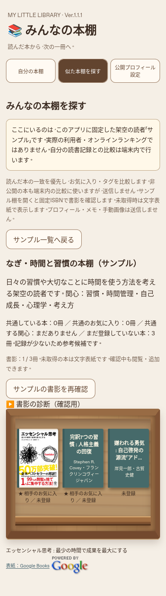
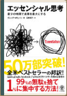
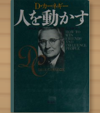

# Ver.1.1.1 サンプル本棚の実書影

検証日：2026-11-19。`index-v111.html` を新規作成しました。旧HTML・旧保存キーは変更・削除していません。追加課金、秘密のAPIキー、サーバーやクラウドDBの導入はありません。サンプル読者は引き続き固定した架空の5人で、実利用者のオンライン共有ではありません。

## 原因と修正

Ver.1.1の`localTextCover()`は文字だけのspanを作り、`renderReaderShelf()`は既存の`queueCovers()`を呼んでいませんでした。この経路では外部サービスに書影があっても表示できません。

サンプル棚を既存の`cover()`・`coverCredit()`・ISBN別取得キューへ接続しました。最初はタイトル・著者の文字表紙を表示し、照合・デコードできた画像へ自動で差し替えます。画像の縦横比は`object-fit: contain`で維持します。取得は非同期で、閲覧・相性計算・本の追加を待たせません。失敗時は文字表示を維持し、架空の実表紙を作成しません。

提供元の出典リンク・Google Booksの標章は既存の表示機能を再利用します。本の高さが出典ロゴでばらつかないよう、出典表記を木製棚の下にまとめました。サンプル棚の文字表紙と実表紙は同じ位置・大きさで並びます。

## 私用データとの分離

`sampleCoverBook()`は固定カタログの書名・著者・単一ISBNとの一致を確認し、取得専用オブジェクトを新規作成します。フィールドは内部の取得用ID、確認済み書名・著者・ISBN、日本語書籍の言語指定、空のimage、固定の出典区分だけです。

自分の本のオブジェクト、`book.image`、`reading`、手動表紙、メモ、プロフィール、公開設定は取得用オブジェクトへ渡しません。同じISBNの自分の本に手動表紙があっても、その画像をサンプルへ流用しません。登録用データとも別で、取得用オブジェクトを自分の本棚へ保存しません。

自動書影キャッシュの読み込みは、次を満たす項目に限定しました。

- キーと証拠のISBNが一致し、ISBNチェック桁・画像寸法・HTTPS画像URLを確認できる。
- 出典がopenBD、Open Library、Google Dynamic Linksのいずれか。device・未知の出典、manual指定、手動画像のbookIdがある項目は採用しない。
- Open Libraryは版IDと出典URLが整合し、画像のホストも提供元と一致する。
- Google Dynamic LinksはISBN10/13の同一性、bib_key、画像と書誌URLのvolume IDが一致する。

新たな画像取得でも既存の書名本体・ISBN照合を使い、不一致の書誌・版・URLを採用しません。Googleはタイトル検索結果の最初の画像や推測した別volumeの画像を借用せず、同ISBNの回答からだけ採用します。外部API自体のデータに誤りがないことを一般的に保証するものではなく、今回の固定8冊については実応答と実画像も確認しました。

公開用JSONの許可リストは変更していません。書影URL・キャッシュ・取得用ID・手動画像・メモは公開用JSONに入りません。プロフィール保存・公開プレビュー・ローカルJSON保存は外部送信しません。サンプル棚を開くと、固定カタログのISBNで書影を問い合わせ、画像URLへアクセスする点を画面に説明しています。従来の自分の本棚の検索・表紙照会も通信を伴う既存機能です。

## キュー・キャッシュ・再試行

- 取得用オブジェクトはISBNごとに1個。同じ本が別のサンプル読者の棚にあっても、同じISBN＋書名キーのキュー・照合結果を共有します。
- 同時・連続の棚切り替えはMapでまとめ、取得済み画像は再照会しません。模擬API試験では、5人の棚の往復で8冊分のISBN照会と8画像の読み込みに収まることを確認しています。
- Ver.1.1以前の検証済み自動書影キャッシュを読み取り、元のキーを上書きせず活用します。新しいキャッシュは`minna-no-hondana.v111.covers`です。
- 永続保存するのは自動書影のURLと照合情報です。画像本体をBase64等で共有キャッシュへ格納しません。画像本体はブラウザのリソースキャッシュに依存し、別ブラウザ・再読み込み時には再取得や再検証が発生し得ます。「再読み込みで画像通信も必ず0件」とは主張しません。
- 取得済みの正しいURLを期限切れだけで文字表紙へ戻しません。実際の画像読み込み失敗は再確認対象にします。
- 未取得はメモリ内の30秒キャッシュで連打を抑制し、失敗を長時間永続保存しません。手動の再確認は30秒間隔で、取得中は追加の再確認を始めません。
- 各提供元の既存タイムアウト、アクセス間隔、429の休止時刻を継承。複数提供元を試している間も本の追加は可能です。
- 通常画面は取得冊数と文字表示を案内します。任意で開く「書影の診断」には、固定8冊に関する提供元別の未提供・ISBN/書名/版不一致・画像読み込み失敗・タイムアウト等を表示します。

## 実APIによる8冊の結果

APIと画像は実通信です。HTMLだけをPagesと同じHTTPSオリジンへローカル供給し、Linux WebKitで検証しました。実際にGitHub Pagesへ配信した検証ではありません。最終の8冊一括確認は約 **4.825秒** でした。これは照会・デコードの計測で、全棚の閲覧や画面キャプチャの時間は含みません。

| 書名・ISBN | openBD | Open Library | Google Dynamic Links | 今回の採用結果 |
| --- | --- | --- | --- | --- |
| 嫌われる勇気 / 9784478025819 | 書誌一致、cover空 | 書名本体不一致で拒否 | 同ISBNのサムネイルなし | 未取得、文字表紙 |
| エッセンシャル思考 / 9784761270438 | 書誌一致、cover空 | 同ISBNの書誌回答なし | 一致画像、128×185 | **実表紙取得** |
| 人を動かす / 9784422100517 | 書誌一致、cover空 | 同ISBN・書名・版を確認、180×269 | OLで解決のため照会対象外 | **実表紙取得** |
| 完訳7つの習慣 / 9784863940246 | 書誌一致、cover空 | 同ISBNの書誌回答なし | 同ISBNのサムネイルなし | 未取得、文字表紙 |
| 苦しかったときの話をしようか / 9784478107829 | 書誌一致、cover空 | 同ISBNの書誌回答なし | 同ISBNのサムネイルなし | 未取得、文字表紙 |
| 幸せになる勇気 / 9784478066119 | 書誌一致、cover空 | 書名本体不一致で拒否 | 一致画像、128×186 | **実表紙取得** |
| 本当の自由を手に入れるお金の大学 / 9784023318786 | 書誌一致、cover空 | 同ISBNの書誌回答なし | 一致画像、128×182 | **実表紙取得** |
| もし高校野球の女子マネージャーがドラッカーの『マネジメント』を読んだら / 9784478012031 | 書誌一致、cover空 | 書名本体不一致で拒否 | 一致画像、128×185 | **実表紙取得** |

**5冊成功、3冊は今回の提供元で画像未提供・書名不一致のため未取得。** この実行では、8冊の最初の確認が全提供元の通信失敗に終わったケースはありません。HTTP200でも画像欄が空の結果、書誌なし、不一致での不採用は、通信エラーと分けて記録しています。書名不一致から外国語版だと推測・断定していません。未取得3冊について、世界中に画像が存在しないと証明したものではありません。

成功した5画像は日本語の実表紙であることを目視し、プレースホルダーやテスト用画像ではないことも確認しました。同ISBNの提供元回答と画像/出典URLの関係を記録しています。Google Books検索の429が解消したという検証ではなく、既存のDynamic Linksによる書影照会の結果です。

詳細は [live-results.json](docs/v111/live-results.json)。ISBN、画像URL、版ID/volume ID、提供元URL、寸法、提供元ごとの診断を含みます。5冊の出典は以下です。

- [エッセンシャル思考：Google Books](https://books.google.com/books?id=XlDMrQEACAAJ)
- [人を動かす：Open Library・同ISBNの版](https://openlibrary.org/books/OL27116041M/)
- [幸せになる勇気：Google Books](https://books.google.com/books?id=YegBkAEACAAJ)
- [お金の大学：Google Books](https://books.google.com/books?id=Ng-hzQEACAAJ)
- [もし高校野球の女子マネージャーが…：Google Books](https://books.google.com/books?id=AC2hXMnyr0wC)

提供元の既存無料APIを使用し、出典リンク・Googleの表示を継承しています。API利用が無料であることを、書影の著作権がなく自由に再配布できるという意味で扱っていません。

## WebKitの実画像表示・再読み込み

iPhone相当（390×664）で5人の棚を実際に開き、5画像についてDOMのデコード・実寸法・opacity=1・object-fit=containを確認しました。再読み込み後も同じ5冊が表示されました。iPad相当（810×1080）は、取得した検証済みURLキャッシュを**隔離したテストプロファイルへ投入**し、実通信で5画像の表示を確認しています。これは端末間同期機能を実装したという意味ではありません。3冊はどの確認でも文字表紙でした。

次は実API画像の画面キャプチャです。生成した架空の実表紙ではありません。読者名と読書記録はアプリ固定の架空サンプルです。







ほかの成功画像と再読み込み後のキャプチャも`docs/v111/`に記録しています。画像を表示しただけで書籍のISBNを画像から自動認識したとは主張しません。

## 自動テスト（模擬API）

```sh
npm ci
npx playwright install chromium webkit
npx playwright test --config=playwright.v111.config.cjs --workers=1
```

Chromium（390×844）、iPhone相当WebKit（390×664）、iPad相当WebKit（810×1080）を対象に、174項目×3構成＝522ケースを実行します。旧版のテストは変更せず、Ver.1.1の154項目を新しいページ・保存キー・バックアップ形式へ合わせた回帰テストと、書影に関する20項目を新規ファイルで用意しました。

模擬画像は「MOCK」と記したSVGで、実書影の成功数に含めません。書影20項目では、文字からの差し替え、取得中の追加、5人の棚の重複照会防止、キャッシュ・再読み込み、旧キャッシュの読み取り、ISBN・書名・版・volume ID不一致、未提供、画像エラー・1px画像、429、タイムアウト、私用画像・データとの分離を確認します。

回帰試験は、5人のサンプル表示、共通本・お気に入り・タグ、未登録本の追加・重複防止、公開用JSONへの秘密文字列・非公開本・手動Base64不混入、公開JSONの復元拒否、旧データ・旧バックアップ・手動表紙・自由配置、保存失敗時の保護等を含みます。プロフィール・JSON操作の通信0件と、サンプル書影通信へ私用メモ・画像・プロフィールを含めないことは分けて確認します。

予備検証はChromium171ケース全成功（1.5分）、iPhone相当WebKitの書影20ケース全成功（1.2分）。出典表示の配置を調整した後、最終ソースで全体を再実行しています。最終結果は末尾に記録しています。

任意の実通信再実行：

```sh
node tests/v111.live.cjs
# 記録先を指定する場合
V111_OUTPUT_DIR=docs/v111 node tests/v111.live.cjs
```

## 保存と互換性

新キーは`minna-no-hondana.v111`、データ版111、自分用バックアップは識別子`minna-no-hondana-backup`の形式5です。Ver.1.1の形式4/版11を検証して引き継ぎ、公開承認も含め、既存の読書記録・タグ・メモ・お気に入り・自由配置・手動表紙を保持します。Ver.1.0.1以前の形式3/101、2/10、1/9も従来と同じく読み込めます。旧形式から新たな公開承認を推測しません。

公開用JSONは従来どおり別識別子`minna-no-hondana-public-profile`・形式1であり、私用データの復元には使えません。新しい自分用バックアップ形式5は旧アプリでは復元できません。容量不足・不正ファイル・別画面の変更時の保護、確認後の復元を維持しています。実際の利用者のブラウザ保存には検証でアクセスしていません。

## 未検証・残る問題

- 3冊は今回のAPIから正しい書影を取得できていません。別版・別言語の画像や架空の実表紙で穴埋めしません。
- 実際のiPhone/iPad Safari、写真・Files等のOS操作、実配信GitHub Pagesは未検証です。Linux WebKitでの端末相当試験です。
- 外部サービスの応答変更、429、CORS・接続エラー、画像URLの失効は起こり得ます。その場合も文字表示で閲覧・追加を維持します。通信失敗の分岐は模擬APIで確認し、今回実通信で429等を再現したとは報告しません。
- 新しいサンプル書影はURLと照合情報のキャッシュです。画像本体の永続保存・オフライン利用や、プロフィールのオンライン公開・同期は実装していません。


## 最終結果と再開時の確認

11月19日の最終ソースで **522ケース全成功・失敗0・スキップ0・自動リトライ0（18.2分）** を確認しました。Chromium、iPhone相当WebKit、iPad相当WebKitで各174ケースです。書影20項目と、Ver.1.1の154項目の回帰試験をそれぞれ3構成で実施しています。

11月24日に作業を再開し、完了したログを確認しました。保存された検証対象ソースのSHA-256と現在のHTML・設定・全テストファイルが一致するため、成功済みの全体テストを改めて実行することはしていません。実APIの5冊取得・3冊未取得の記録は11月19日時点のものです。11月24日現在の提供状況を再照会したという意味ではありません。

件数・対象構成・ソースハッシュ・実API結果の区分は [test-results.json](docs/v111/test-results.json) に記録しました。利用制限で停止したのは成果物をGitHubへ登録する段階で、実装・最終テスト結果・実API記録は保存されていました。PRは新規作成し、マージせずレビュー待ちにします。
